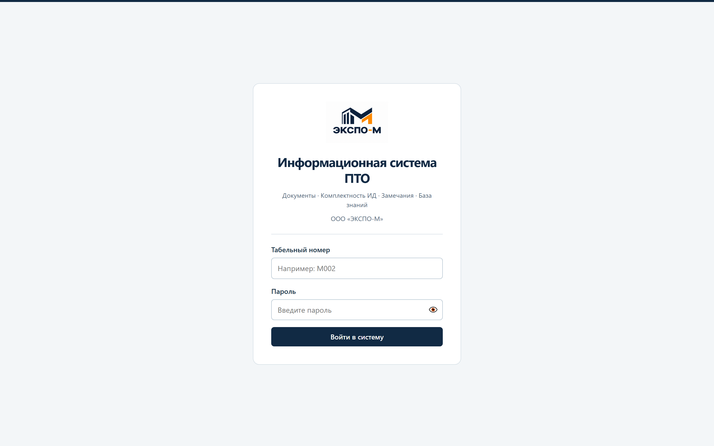
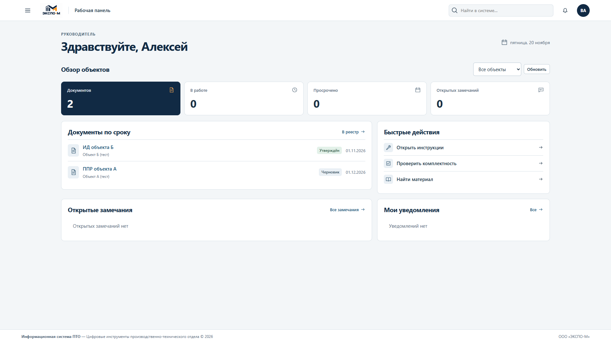
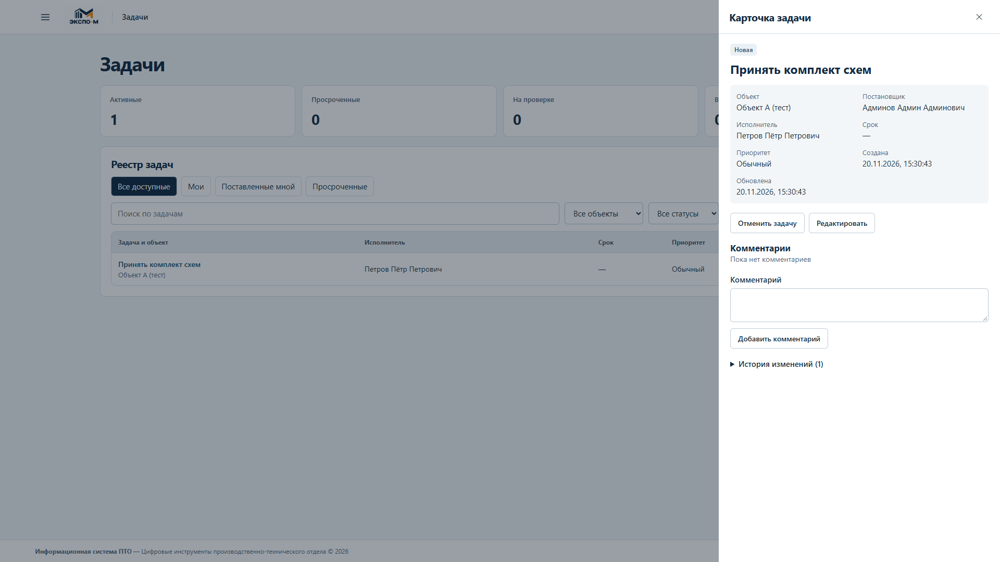

# Информационная система ПТО — ООО «ЭКСПО-М»

Корпоративная информационная система производственно-технического отдела: строительные объекты, реестр документов и исполнительной документации, контроль комплектности ИД и замечаний, задачи с историей и версиями, отчёты, база знаний и инструкции, страница компании с фотографиями строительства.

Проект развивается как основа цифровой системы ПТО ООО «ЭКСПО-М». Пилотный объект-кандидат — «Региональный ЦОД в Балаково» (Саратовская область); окончательное решение за руководством компании.

**Версия:** 2.2.0. **Тесты:** 138/138. **Стек:** Node.js, Express 5, SQLite, Vanilla JS без сборки.







## Что умеет система

| Раздел | Возможности |
| --- | --- |
| **Рабочая панель** | Показатели по объектам: документы, в работе, просрочено, открытые замечания; документы по сроку, быстрые действия, уведомления |
| **Строительные объекты** | Реестр объектов, карточка объекта, фотографии строительства, доступ сотрудников по объектам |
| **Задачи** | Статусы «Новая → В работе → На проверке → Выполнена/Отменена», приоритеты, исполнитель, срок, связь с документом и замечанием, комментарии, история, контроль версии карточки, свободные задачи |
| **Реестр документов** | ИД, ППР, акты скрытых работ, журналы работ, входной контроль; статусы, сроки, ответственные, файлы, редакции, история, CSV-реестр |
| **Исполнительная документация** | Отдельный срез реестра по ИД с фильтрами и быстрым доступом |
| **Комплектность ИД** | Настраиваемые комплекты и требования, привязка документов, отчёт о недостающих позициях |
| **Замечания** | Номер, объект, документ, срок, ответственный, статусы, комментарии, вложения, история |
| **Просмотр документов** | PDF, DOCX, XLSX, CSV/TXT, изображения внутри системы; DOC/XLS — через локальный LibreOffice; отдельное скачивание оригинала |
| **Отчёты** | Сводка по объекту и периоду, распределение по статусам, CSV-выгрузки документов и замечаний |
| **База знаний и инструкции** | Статьи по видам работ и работам, инструкции, файлы, поиск и фильтры |
| **О компании** | Страница ООО «ЭКСПО-М», текущий проект, фотографии строительства (загружает администратор) |
| **Сотрудники и доступы** | Роли, блокировка, сброс пароля, доступ к объектам, журнал действий |
| **Уведомления** | В приложении: сроки, просрочки, смены статусов, назначения, новые замечания, задачи |
| **Поиск** | Полнотекстовый поиск SQLite FTS5 с безопасной подсветкой и подсказками |

## Роли

| Роль | Права |
| --- | --- |
| Монтажник | просмотр каталога, инструкций и документов доступных объектов |
| Старший монтажник | управление каталогом знаний: статьи, работы, виды работ |
| Инженер ПТО | документы ПТО, комплектность, замечания, задачи, импорт и реестры в пределах доступных объектов |
| Руководитель | чтение всех объектов, документов, замечаний и отчётов; управление задачами; без изменения документов, комментариев к замечаниям и администрирования |
| Администратор | всё, включая сотрудников, роли, доступ к объектам, фотографии компании и журнал действий |

Доступ к объектам назначается администратором. Руководитель и администратор видят все объекты; остальные — только назначенные. Действующая роль проверяется сервером при каждом запросе.

## Технологии

- Node.js (проверено на v26.13.0; поддержка `>=20 <27`, версия в `.nvmrc`), Express 5
- SQLite + `better-sqlite3` (WAL, внешние ключи, централизованные миграции)
- HTML5, CSS3, Vanilla JavaScript (без сборки)
- REST API, `express-session` с SQLite-хранилищем, `bcryptjs`, `multer`
- Полнотекстовый поиск SQLite FTS5 (с резервным режимом LIKE)
- Собственные парсеры DOCX/XLSX и извлечение текста без внешних сервисов; LibreOffice — только для старых DOC/XLS
- Транзакционная запись документов и файлов, идемпотентность операций, проверяемое резервное копирование

## Быстрый старт (локально)

```bash
npm ci
cp .env.example .env        # заполните SESSION_SECRET и пути новой установки
npm run migrate
npm run init-admin          # параметры администратора — см. раздел ниже
npm start                   # http://127.0.0.1:3001
```

Проверка: `npm test` — 138 автотестов на изолированных временных БД.

## Конфигурация

Все параметры — в `.env` (шаблон: `.env.example`). Основные:

| Переменная | Назначение |
| --- | --- |
| `PORT`, `HOST` | адрес прослушивания (в production `HOST=127.0.0.1` за Nginx) |
| `NODE_ENV` | `production` включает строгие проверки |
| `SESSION_SECRET` | обязательный секрет ≥ 32 символов в production |
| `SESSION_TIMEOUT_MINUTES` | время жизни сессии (по умолчанию 480) |
| `DATABASE_PATH`, `UPLOADS_PATH` | пути к БД и файлам |
| `BACKUP_PATH`, `BACKUP_KEEP` | каталог и глубина хранения резервных копий |
| `LOG_PATH` | каталог журналов |
| `TRUST_PROXY`, `COOKIE_SECURE`, `ENABLE_HSTS` | работа за reverse-proxy и HTTPS |
| `TRUSTED_ORIGINS` | разрешённые источники для CORS (пусто — CORS отключён) |
| `ALLOW_DEMO_ACCOUNTS` | `0` в production — демо-учётки запрещены |
| `AI_*` | параметры будущего ИИ-провайдера (по умолчанию отключено) |

## Скрипты

| Команда | Назначение |
| --- | --- |
| `npm start` / `npm run dev` | запуск сервера / с автоперезагрузкой |
| `npm test` | автоматические тесты (node:test) |
| `npm run migrate` | применить миграции и показать список |
| `npm run init-admin` | создать первого администратора в базе без сотрудников |
| `npm run backup` | резервная копия БД и файлов + проверка |
| `npm run restore -- <каталог> --force` | восстановление из копии |
| `npm run report-filenames` | dry-run отчёт об искажённых именах файлов; `--apply` — исправить только БД |
| `npm run seed` | демо-данные каталога (не перезаписывает существующую БД) |
| `npm run migrate-pto` | демо-документы ПТО и демо-инженер ПТО |
| `npm run generate-pdfs` | демо-PDF для статей |

Дополнительно в `scripts/` есть браузерные проверки (`check-ui-redesign.mjs`, `check-tasks-browser.mjs`, `check-lead-browser.mjs`, `check-search-browser.mjs`) — запускаются вручную против работающего стенда.

## Безопасность

- Пароли — bcrypt; вход по табельному номеру; блокировка после неудачных попыток; защита от перебора.
- Сессии в SQLite, `HttpOnly` + `SameSite=Lax`, в production — `Secure`; CSRF-токен для изменяющих запросов.
- Прямая раздача `uploads` отключена: файлы доступны только через API с проверкой прав.
- Объектный охват данных применяется к спискам, карточкам, файлам, поиску, отчётам и уведомлениям.
- Заголовки безопасности (CSP, X-Frame-Options, X-Content-Type-Options, Referrer-Policy), CORS по allowlist, лимиты частоты запросов.
- Журнал действий пользователей (таблица `Аудит`), понятные ошибки с `requestId` без внутренних деталей.
- Резервное копирование с контрольными суммами, проверкой целостности SQLite и внешних ключей; восстановление — только с `--force`.
- Создание первого администратора отдельной командой, демонаполнение запрещено в production.

Подробно: [SECURITY_REPORT.md](SECURITY_REPORT.md).

## Структура проекта

```
.
├── server.js                 # точка входа production
├── app.js                    # фабрика приложения (middleware, роутеры)
├── config.js                 # конфигурация из .env
├── lib/                      # db, миграции, права, безопасность, файлы, поиск, preview,
│                             # office (DOCX/XLSX/конвертация), tasks, уведомления, аудит,
│                             # резервное копирование, ИИ-заготовка
├── routes/                   # auth, staff, catalog, pto, files, preview, completeness,
│                             # remarks, notifications, reports, tasks, company-photos,
│                             # search, import, ai
├── frontend-html/            # интерфейс (index.html, app.js, tasks.js, styles.css, img/)
├── tests/                    # 18 файлов автотестов (node:test)
├── scripts/                  # backup, restore, migrate, init-admin, браузерные проверки
├── deploy/                   # nginx.conf, infoteh.service, backup.cron
├── docs/                     # скриншоты для README
├── uploads/                  # файлы документов и фото компании (не раздаются напрямую)
├── reports/                  # отчёты и артефакты проверок
├── backups/                  # резервные копии (вне Git)
├── logs/                     # журналы (вне Git)
└── infoteh.db                # база SQLite (вне Git)
```

## Маршруты API (кратко)

- `POST /api/auth/login|logout`, `GET /api/auth/session`, `POST /api/auth/password`
- `GET|POST|PUT|DELETE /api/sotrudniki`, `PUT /api/sotrudniki/:id/role|password|access|block`, `GET /api/audit`
- `GET|POST|PUT|DELETE /api/vidy-rabot`, `/api/raboty`, `/api/articles`, `/api/objects`
- `GET|POST|PUT|DELETE /api/pto`, `PATCH /api/pto/:id/status`, `GET /api/pto/meta`, `GET /api/pto/export.csv`
- `GET /api/files/{article,document,revision,remark}/:id` (`?disposition=inline|attachment`)
- `GET /api/preview/{document,revision,remark}/:id`, `/content`, `/pdf`
- `GET|POST|PATCH /api/tasks`, `POST /api/tasks/:id/transitions|comments`, `GET /api/tasks/:id/history|summary|meta|targets`
- `GET|POST /api/company/photos`, `GET /api/company/photos/:name`
- `GET|POST|PUT|DELETE /api/completeness...`, `/api/remarks...`, `/api/notifications...`
- `GET /api/reports/summary|documents.csv|remarks.csv`, `GET /api/search|search/status`
- `POST /api/import/preview|commit`, `GET /api/ai/status`, `POST /api/ai/*` (заглушки при отключённом провайдере)

## Тесты

- **138 автотестов** в 18 файлах: авторизация, роли, объектные права, задачи, роль руководителя, целостность файлов и документов, резервное копирование и восстановление, комплектность, замечания, поиск, просмотр, кириллица в именах, брендинг, провижининг, фотографии компании, body-parser.
- Дополнительно: браузерные проверки интерфейса (адаптивность, клавиатура, четыре разрешения руководителя) — в `scripts/check-*.mjs`.
- Результаты: [TEST_REPORT.md](TEST_REPORT.md), [PROJECT_SUMMARY.md](PROJECT_SUMMARY.md).

## Документация

| Документ | Содержание |
| --- | --- |
| [PROJECT_SUMMARY.md](PROJECT_SUMMARY.md) | краткая сводка конечной версии: модули, готовность, ограничения |
| [PROJECT_STATUS.md](PROJECT_STATUS.md) | оценка готовности и условия пилота |
| [TEST_REPORT.md](TEST_REPORT.md) | результаты тестов и чек-лист приёмки |
| [SECURITY_REPORT.md](SECURITY_REPORT.md) | меры безопасности и остаточные риски |
| [TECHNICAL_CHANGELOG.md](TECHNICAL_CHANGELOG.md) | изменения по версиям и файлам |
| [USER_MANUAL_PTO.md](USER_MANUAL_PTO.md) | инструкция пользователя |
| [DEPLOYMENT_RU_VPS.md](DEPLOYMENT_RU_VPS.md) | размещение на российском VPS |
| [DATABASE_MIGRATIONS.md](DATABASE_MIGRATIONS.md) | миграции и схема |
| [ADMIN_USERS_BUGFIX_REPORT.md](ADMIN_USERS_BUGFIX_REPORT.md) | исправление списка сотрудников |
| [FILE_HANDLING_AND_PREVIEW_REPORT.md](FILE_HANDLING_AND_PREVIEW_REPORT.md) | имена файлов и встроенный просмотр |
| [ROADMAP.md](ROADMAP.md) | план развития |

## Первоначальный администратор

`npm run init-admin` принимает `INIT_ADMIN_TAB`, `INIT_ADMIN_NAME`, `INIT_ADMIN_PASSWORD`; пароль — через скрытый ввод или хранилище секретов. Повторный запуск при наличии сотрудников завершается отказом. В production демонаполнение запрещено.

## Демо-данные

Для отдельного демостенда: `NODE_ENV=development`, `ALLOW_DEMO_ACCOUNTS=1`, отдельные `DATABASE_PATH`, каталоги загрузок и журналов. Затем `npm run seed` и `npm run migrate-pto`. Пароли демо-учёток задаются через `SEED_*` переменные; в production демо-вход запрещён.

## Известные ограничения

- XLSX-выгрузка отчётов не реализована (CSV открывается в Excel).
- OCR сканированных документов не реализован: файлы помечаются «Требует OCR».
- Уведомления только внутри приложения (без e-mail и мессенджеров).
- Электронная подпись и юридически значимое согласование не реализованы.
- ИИ-функции не подключены; есть архитектурная заготовка.
- Аудит действий доступен через API; отдельного экрана журнала нет.
- DOC/XLS просматриваются только при установленном на сервере LibreOffice.
- Задачи не имеют диаграммы Ганта и календарного планирования; фото компании загружает только администратор.

## Права на продукт

Система является авторской разработкой. Условия использования в ООО «ЭКСПО-М» (лицензия, поддержка, доработки) оформляются отдельным договором. Публикация кода в репозитории не означает передачу исключительных прав.

## Развёртывание

Инструкция: [DEPLOYMENT_RU_VPS.md](DEPLOYMENT_RU_VPS.md). Кратко: российский VPS, Node.js 20–26, `.env` с `SESSION_SECRET`, миграции, `init-admin`, systemd, Nginx с HTTPS, ежедневный backup и проверка восстановления.
