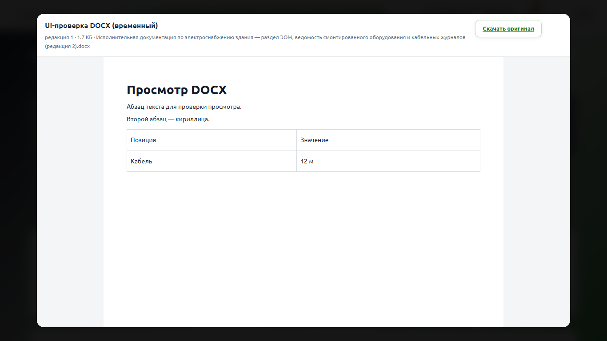

# Информационная система ПТО — ООО «ИНФОТЕХ БАЛАКОВО»

Корпоративная информационная система производственно-технического отдела: реестр документов по объектам (ИД, ППР, акты, журналы, входной контроль), контроль сроков, статусов, редакций и комплектности ИД, замечания, отчёты, встроенный просмотр документов и база знаний для монтажных специальностей.

Проект развивается как основа цифровой системы ПТО ООО «СтройМонтажГрупп» (пилот — «Региональный ЦОД в г. Балаково»).




## Что умеет система

| Раздел | Возможности |
| --- | --- |
| **Панель ПТО** | Фактические показатели: документы, в работе, утверждено, просрочено, замечания, комплектность, доля сданных в срок; глобальный поиск |
| **Документы ПТО** | Реестр по объектам: ИД, ППР, акты скрытых работ, журналы работ, входной контроль; статусы, сроки, ответственные, файлы (PDF/DOC/DOCX/XLS/XLSX/TXT/CSV/PNG/JPEG), редакции, история, CSV-реестр |
| **Просмотр документов** | Внутри системы: PDF, DOCX, XLSX (листы и ячейки), CSV/TXT, изображения; DOC/XLS — через локальный LibreOffice; отдельная кнопка скачивания оригинала с исходным именем |
| **Комплектность ИД** | Настраиваемые комплекты и требования, привязка документов, отчёт о недостающих позициях |
| **Замечания** | Реестр замечаний: номер, объект, документ, срок, ответственный, статусы (настраиваемые), комментарии, вложения, история |
| **Отчёты** | Сводка по объекту и периоду, распределение по статусам, CSV-выгрузки документов и замечаний |
| **Каталог знаний** | Статьи и инструкции по видам работ и работам, файлы, поиск, фильтры |
| **Сотрудники** | Роли, блокировка, сброс пароля, доступ к объектам, журнал действий (API) |
| **Уведомления** | В приложении: сроки, просрочки, смены статусов, назначения, новые замечания |

## Технологии

- Node.js (проверено на v26.13.0; поддержка `>=20 <27`, версия в `.nvmrc`), Express 5
- SQLite + `better-sqlite3` (WAL, внешние ключи, централизованные миграции)
- HTML5, CSS3, Vanilla JavaScript (без сборки)
- REST API, `express-session` с SQLite-хранилищем, `bcryptjs`, `multer`
- Полнотекстовый поиск SQLite FTS5 (с резервным режимом LIKE)
- Собственные парсеры DOCX/XLSX (без внешних сервисов); LibreOffice — только для старых DOC/XLS
- Извлечение текста из PDF/DOCX/XLSX без внешних зависимостей

## Быстрый старт (локально)

```bash
npm ci
cp .env.example .env        # заполните SESSION_SECRET и пути новой установки
npm run migrate
npm run init-admin          # передайте параметры администратора по инструкции ниже
npm start                   # http://127.0.0.1:3001
```

Проверка: `npm test` — автоматические тесты (изолированные временные БД).

## Конфигурация

Все параметры — в `.env` (шаблон: `.env.example`). Основные:

| Переменная | Назначение |
| --- | --- |
| `PORT`, `HOST` | адрес прослушивания (в production `HOST=127.0.0.1` за Nginx) |
| `NODE_ENV` | `production` включает строгие проверки |
| `SESSION_SECRET` | обязательный секрет ≥ 32 символов в production |
| `SESSION_TIMEOUT_MINUTES` | время жизни сессии (по умолчанию 480) |
| `DATABASE_PATH`, `UPLOADS_PATH` | пути к БД и файлам |
| `BACKUP_PATH`, `BACKUP_KEEP` | каталог и глубина хранения резервных копий |
| `LOG_PATH` | каталог журналов |
| `TRUST_PROXY`, `COOKIE_SECURE`, `ENABLE_HSTS` | работа за reverse-proxy и HTTPS |
| `TRUSTED_ORIGINS` | разрешённые источники для CORS (пусто — CORS отключён) |
| `ALLOW_DEMO_ACCOUNTS` | `0` в production — демо-учётки запрещены |
| `AI_*` | параметры будущего ИИ-провайдера (по умолчанию отключено) |

## Скрипты

| Команда | Назначение |
| --- | --- |
| `npm start` / `npm run dev` | запуск сервера / с автоперезагрузкой |
| `npm test` | автоматические тесты (node:test) |
| `npm run migrate` | применить миграции и показать список |
| `npm run backup` | резервная копия БД и файлов + проверка |
| `npm run restore -- <каталог> --force` | восстановление из копии |
| `npm run report-filenames` | dry-run отчёт об искажённых именах файлов; `--apply` — исправить только БД |
| `npm run init-admin` | создать первого администратора в базе без сотрудников |
| `npm run seed` | демо-данные каталога (не перезаписывает существующую БД) |
| `npm run migrate-pto` | демо-документы ПТО и демо-инженер ПТО |
| `npm run generate-pdfs` | демо-PDF для статей |

## Роли

| Роль | Права |
| --- | --- |
| Монтажник | просмотр каталога и документов доступных объектов |
| Старший монтажник | каталог знаний: статьи, работы, виды работ |
| Инженер ПТО | документы ПТО, комплекты, замечания, импорт, реестры — в пределах доступных объектов |
| Администратор | всё, включая сотрудников, доступ к объектам и журнал действий |

Доступ к объектам назначается администратором. Сотрудник без назначенных объектов не видит документы этих объектов.

## Безопасность

- Пароли — bcrypt; вход по табельному номеру; блокировка после 5 неудачных попыток.
- Сессии в SQLite, `HttpOnly` + `SameSite=Lax`, в production — `Secure`; CSRF-токен для изменяющих запросов.
- Прямая раздача `uploads` отключена: файлы доступны только через API с проверкой прав.
- Заголовки безопасности (CSP, X-Frame-Options, X-Content-Type-Options, Referrer-Policy), CORS по allowlist, лимиты частоты запросов.
- Журнал действий пользователей (таблица `Аудит`), понятные ошибки с `requestId` без внутренних деталей.
- Резервное копирование с проверкой контрольных сумм и `integrity_check`.

Подробно: [SECURITY_REPORT.md](SECURITY_REPORT.md).

## Структура проекта

```
.
├── server.js                 # точка входа production
├── app.js                    # фабрика приложения (middleware, роутеры)
├── config.js                 # конфигурация из .env
├── lib/                      # db, миграции, безопасность, файлы, поиск, preview,
│                             # office (DOCX/XLSX/конвертация),
│                             # уведомления, аудит, резервное копирование, ИИ-заготовка
├── routes/                   # auth, staff, catalog, pto, files, completeness,
│                             # remarks, notifications, reports, search, import, ai
├── frontend-html/            # интерфейс (index.html, app.js, styles.css, img/)
├── tests/                    # автотесты (node:test)
├── scripts/                  # backup, restore, migrate
├── deploy/                   # nginx.conf, infoteh.service, backup.cron
├── uploads/                  # файлы документов (не раздаются напрямую)
├── reports/                  # отчёты dry-run (вне Git)
├── backups/                  # резервные копии (вне Git)
├── logs/                     # журналы (вне Git)
└── infoteh.db                # база SQLite (вне Git)
```

## Маршруты API (кратко)

- `POST /api/auth/login|logout`, `GET /api/auth/session`, `POST /api/auth/password`
- `GET|POST|PUT|DELETE /api/sotrudniki`, `PUT /api/sotrudniki/:id/role|password|access|block`, `GET /api/audit`
- `GET|POST|PUT|DELETE /api/vidy-rabot`, `/api/raboty`, `/api/articles`, `/api/objects`
- `GET|POST|PUT|DELETE /api/pto`, `PATCH /api/pto/:id/status`, `GET /api/pto/meta`, `GET /api/pto/export.csv`
- `GET /api/files/{article,document,revision,remark}/:id` (параметр `?disposition=inline|attachment`)
- `GET /api/preview/{document,revision,remark}/:id`, `/content`, `/pdf` — встроенный просмотр
- `GET|POST|PUT|DELETE /api/completeness...`, `/api/remarks...`, `/api/notifications...`
- `GET /api/reports/summary|documents.csv|remarks.csv`, `GET /api/search|search/status`
- `POST /api/import/preview|commit`, `GET /api/ai/status`, `POST /api/ai/*` (заглушки при отключённом провайдере)

## Документация

| Документ | Содержание |
| --- | --- |
| [TECHNICAL_CHANGELOG.md](TECHNICAL_CHANGELOG.md) | полный список изменений по файлам и модулям |
| [SECURITY_REPORT.md](SECURITY_REPORT.md) | устранённые проблемы, остаточные риски, проверки |
| [TEST_REPORT.md](TEST_REPORT.md) | результаты тестов, чек-лист приёмки |
| [FILE_HANDLING_AND_PREVIEW_REPORT.md](FILE_HANDLING_AND_PREVIEW_REPORT.md) | кириллица в именах файлов и встроенный просмотр |
| [BRANDING_UPDATE_REPORT.md](BRANDING_UPDATE_REPORT.md) | ребрендинг «Информационная система ПТО» |
| [ACCEPTANCE_REPORT.md](ACCEPTANCE_REPORT.md) | приёмка этапа: тесты, чек-лист, ограничения |
| [DEPLOYMENT_RU_VPS.md](DEPLOYMENT_RU_VPS.md) | размещение и эксплуатация на российском VPS |
| [DATABASE_MIGRATIONS.md](DATABASE_MIGRATIONS.md) | миграции, схема, резервирование |
| [USER_MANUAL_PTO.md](USER_MANUAL_PTO.md) | инструкция пользователя ПТО |
| [ROADMAP.md](ROADMAP.md) | план развития |
| [PROJECT_STATUS.md](PROJECT_STATUS.md) | итоговая оценка готовности |
| [REPORT_PTO_AUDIT.md](REPORT_PTO_AUDIT.md) | первичный технический аудит (до модернизации) |

## Первоначальный администратор

После миграций передайте локальной команде `npm run init-admin` переменные окружения `INIT_ADMIN_TAB`, `INIT_ADMIN_NAME` и `INIT_ADMIN_PASSWORD`. Получите пароль через скрытый ввод или хранилище секретов. Пример для Bash приведён в разделе 3 руководства DEPLOYMENT_RU_VPS.md. Команда принимает действующую в приложении политику паролей и лимит bcrypt в 72 байта. Повторный запуск при наличии любого сотрудника завершится отказом.

## Демо-данные

Для отдельного демостенда задайте `NODE_ENV=development`, `ALLOW_DEMO_ACCOUNTS=1`, свободный `DATABASE_PATH` и отдельные каталоги загрузок и журналов. Запустите `npm run seed`, затем `npm run migrate-pto`. Если нужен вход, до наполнения передайте пароли через `SEED_ADMIN_PASSWORD` (ADM002), `SEED_SENIOR_PASSWORD` (SM002), `SEED_WORKER_PASSWORD` (M002) и `SEED_PTO_PASSWORD` (PTO01) для соответствующих тестовых ролей. Для остальных записей скрипт генерирует случайные пароли. В production демонаполнение и вход демонстрационных пользователей запрещены.

## Известные ограничения

- XLSX-выгрузка отчётов не реализована (CSV открывается в Excel).
- OCR сканированных документов не реализован: такие файлы помечаются «Требует OCR».
- Уведомления только внутри приложения (без e-mail и мессенджеров).
- Электронная подпись и юридически значимое согласование не реализованы.
- ИИ-функции не подключены; предусмотрена архитектурная заготовка.
- Аудит действий доступен через API; экран журнала — в плане развития.
- DOC/XLS просматриваются только при установленном на сервере LibreOffice; иначе предлагается скачивание.
- Сложное форматирование DOCX (формулы, сноски, колонтитулы) и формулы XLSX в просмотре не отображаются/не вычисляются.

## Лицензия

Учебный/корпоративный проект. Права на программный продукт оформляются отдельно (см. `PROJECT_STATUS.md`).
