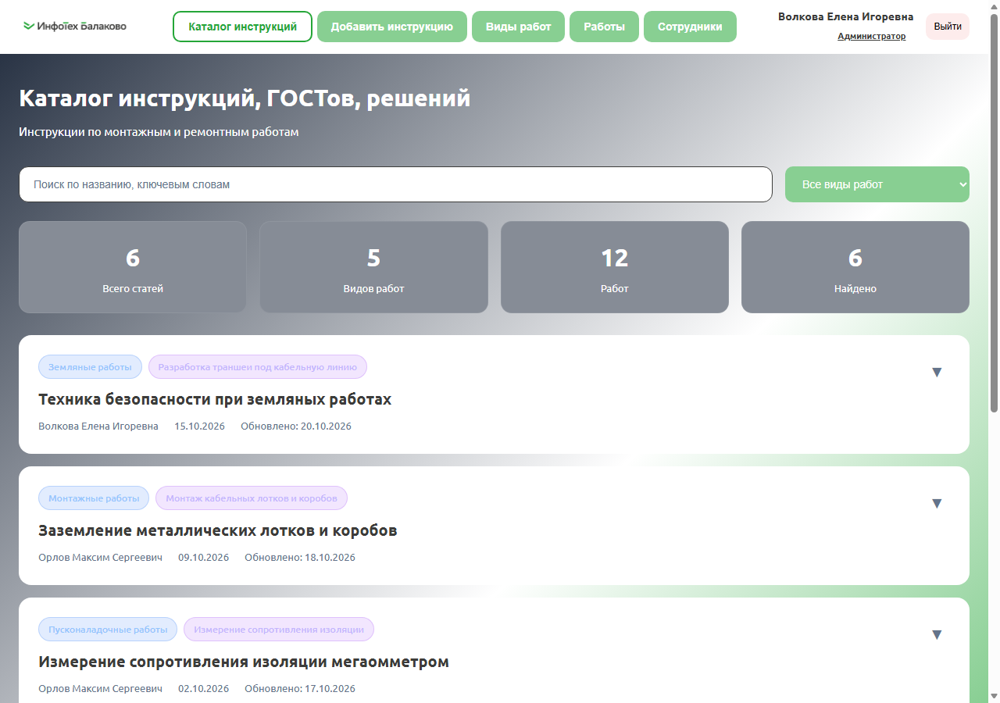
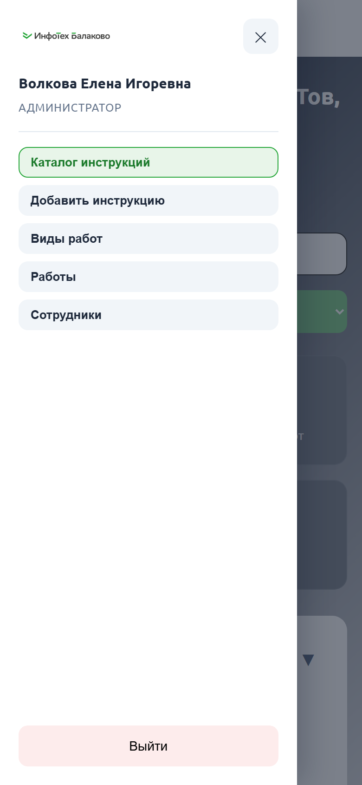

# ИнфоТех — база знаний для монтажников

Веб-приложение, в котором монтажники и инженеры хранят инструкции, ГОСТы и готовые решения по монтажным, ремонтным и земляным работам. Вместо переписок в мессенджерах и разрозненных PDF на сетевом диске — единый каталог с поиском, фильтрами и понятной структурой «вид работ → работа → инструкция».

Проект решает три задачи:

- **Для монтажника** — быстро найти нужную инструкцию с телефона, открыть PDF и посмотреть, когда документ обновляли.
- **Для старшего монтажника** — поддерживать базу в актуальном состоянии: добавлять и редактировать инструкции, работы и виды работ.
- **Для администратора** — управлять сотрудниками и ролями, не давая лишних прав.

> Учебный проект, выполненный как дипломная работа и оформленный как портфолио-кейс.



## Стек технологий

| Слой | Технологии |
| --- | --- |
| Backend | Node.js 20+, Express 5 |
| База данных | SQLite, better-sqlite3 |
| Frontend | Vanilla JavaScript, HTML5, CSS3 |
| Авторизация | bcryptjs, express-session |
| Загрузка файлов | multer (PDF до 10 МБ) |
| Запуск | npm-скрипты, без сборки фронтенда |

Архитектура намеренно простая: один Express-процесс отдаёт статический интерфейс, REST API и загруженные PDF, а данные хранит в одном файле SQLite.

```
Браузер (Vanilla JS)
        │  fetch /api/*
        ▼
Express 5 (server.js)
        │  better-sqlite3
        ▼
infoteh.db  +  uploads/*.pdf
```

## Ключевые фичи

- **Авторизация по табельному номеру.** Пароли хранятся в виде bcrypt-хешей, сессия — в HttpOnly-cookie с SameSite=Lax.
- **Роли и права.** Монтажник только смотрит каталог; старший монтажник управляет контентом; администратор управляет сотрудниками. Все проверки прав выполняются на сервере, а не только в интерфейсе.
- **CRUD по контенту.** Статьи, работы и виды работ можно создавать, редактировать и удалять. У статей дата обновления выводится в карточке, у работ и видов хранится в базе.
- **PDF-инструкции.** Файл прикрепляется к статье, открывается в новой вкладке или скачивается. При замене файла старый удаляется.
- **Поиск и фильтры.** Поиск по названию, тексту, ключевым словам и виду работ; фильтр по категории.
- **Адаптивный интерфейс.** На телефоне — компактная шапка и боковое меню с навигацией и выходом.
- **Понятные ошибки.** Истёкшая сессия и недостаток прав обрабатываются отдельно, с возвратом на экран входа.
- **Демо-данные из коробки.** Seed-скрипт создаёт базу с 3 сотрудниками, 5 видами работ, 12 работами и 6 статьями; генератор создаёт PDF для инструкций.

### Мобильная версия

<p>
  
  
</p>

## Структура проекта

```
.
├── server.js                 # Express-сервер, API, сессии, загрузка PDF
├── seed.js                   # создание и наполнение infoteh.db
├── generate-pdfs.js          # генерация демо-PDF по путям из БД
├── migrate-updated-at.js     # миграция старых баз: updated_at, Фото → Файл
├── hash-passwords.js         # миграция старых баз: bcrypt для паролей
├── frontend-html/
│   ├── index.html            # разметка интерфейса
│   ├── app.js                # логика каталога, ролей, модалок и меню
│   ├── styles.css            # стили и адаптивность
│   └── img/                  # логотип и favicon
├── uploads/                  # PDF-инструкции (создаются генератором)
├── docs/                     # скриншоты для README
├── infoteh.db                # локальная база (создаётся seed-скриптом)
└── package.json
```

## Установка и запуск

### Требования

- Node.js 20 или новее
- npm

### Шаги

```bash
# 1. Скачайте репозиторий и перейдите в папку проекта
git clone <ссылка-на-репозиторий>
cd infoteh

# 2. Установите зависимости
npm install

# 3. Создайте базу и наполните её демо-данными
npm run seed

# 4. Сгенерируйте PDF-файлы для инструкций
npm run generate-pdfs

# 5. Запустите сервер
npm start
```

Приложение откроется по адресу: **http://localhost:3001**

### Если база уже существует

`npm run seed` не перезаписывает существующую `infoteh.db`, чтобы не потерять данные. Чтобы пересоздать базу с нуля:

```bash
npm run seed -- --force
npm run generate-pdfs
```

### Что делает каждый скрипт

| Команда | Назначение |
| --- | --- |
| `npm start` | Запуск Express-сервера на порту 3001 |
| `npm run seed` | Создание `infoteh.db` и наполнение демо-данными |
| `npm run generate-pdfs` | Генерация PDF по путям из колонки `Статья.Файл`; существующие файлы не перезаписываются (`-- --force` для перезаписи) |
| `npm run migrate` | Миграция старой базы: `updated_at` и `Фото` → `Файл` |
| `npm run hash-passwords` | Перевод старых открытых паролей в bcrypt-хеши |

`migrate` и `hash-passwords` нужны только для баз, созданных до появления соответствующих изменений. Для новой базы после `npm run seed` они не требуются.

## Учётные данные

| Роль | Табельный номер | Пароль | Доступ |
| --- | --- | --- | --- |
| Администратор | `ADM002` | `admin` | Всё: контент + сотрудники |
| Старший монтажник | `SM002` | `qwerty` | Контент: статьи, работы, виды работ |
| Монтажник | `M002` | `12345` | Только просмотр каталога |

## Безопасность

- Пароли не хранятся в открытом виде — только bcrypt-хеши.
- Сессия хранится в cookie `HttpOnly`, `SameSite=Lax`; время жизни — 8 часов.
- Секрет сессии генерируется случайно при старте. Для постоянного секрета задайте `SESSION_SECRET`.
- Все изменяющие запросы защищены проверкой сессии и роли на сервере.
- При каждом запросе роль сверяется с базой: удалённый сотрудник или сотрудник с изменённой должностью теряет доступ сразу.
- Загружаются только PDF, ограничение размера — 10 МБ.
- Пароль нового сотрудника хешируется при создании.

## Планы по развитию

- **Полнотекстовый поиск на FTS5.** Сейчас поиск выполняется на клиенте по загруженному каталогу; с ростом базы стоит перенести его в SQLite FTS5.
- **PWA и офлайн-режим.** Кэширование каталога и PDF через Service Worker, чтобы инструкции открывались в подвале и на объекте без сети.
- **CSRF-защита.** Добавить токены для форм и SameSite=Strict для чувствительных операций.
- **Rate limiting.** Ограничить попытки входа и запросы к API.
- **Production-хранилище сессий.** Заменить MemoryStore на Redis или SQLite-хранилище, чтобы сессии переживали перезапуск и работали в нескольких инстансах.
- **История версий инструкций.** Хранить предыдущие редакции и показывать, что именно изменилось.
- **Вложения-изображения и видео.** Сейчас поддерживается только PDF, хотя монтажным инструкциям часто нужны схемы и фотографии.
- **Тесты и CI.** Добавить API-тесты, линтер и GitHub Actions.
- **HTTPS и secure-cookie.** Включить `secure: true`, `trust proxy` и заголовки безопасности при размещении за reverse-proxy.

## Лицензия

Проект создан в учебных целях. Демо-данные и PDF сгенерированы специально для портфолио и не являются производственной документацией.
